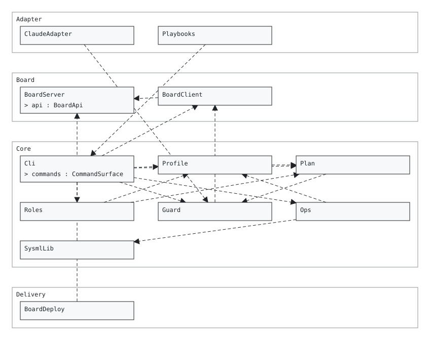

# Architecture

12 part defs in 4 packages, 17 dependencies and 0 connections, generated from sysml/model/. Change it with a plan, never by hand.

<!-- generated by tld ops sysml render, layout 1; do not edit -->

## Adapter

The Claude Code plugin content: hooks, commands and the playbooks agents follow.

| Part def | Ports | Description |
| --- | --- | --- |
| `ClaudeAdapter` |  | Turns Claude Code hook events into guard actions and declares the plugin commands, skills, agents and board MCP server. |
| `Playbooks` |  | Markdown procedures, role prompts, checklists and stack guides that agents follow and that call the tld command line. |

## Board

The status board: a small service for status records and asks, and the client that talks to it.

| Part def | Ports | Description |
| --- | --- | --- |
| `BoardServer` | `api` : `BoardApi` | Stores status records and asks and serves the owner's web page. |
| `BoardClient` |  | Reads and writes records and asks over the board interface and bridges it to MCP over standard input and output. |

## Core

The tld library: the command line and the rules, plans and operations behind it.

| Part def | Ports | Description |
| --- | --- | --- |
| `Cli` | `commands` : `CommandSurface` | Dispatches each tld group and command to the module that runs it. |
| `Profile` |  | Validates, resolves and patches the project profile against its schema. |
| `Plan` |  | Validates plan manifests and tracks phase status, scope drift and active runs. |
| `Roles` |  | Decides which review roles a point requires and verifies their reports. |
| `Guard` |  | Tool-agnostic guard rules and the definition-of-done gate; each rule maps an action to a decision. |
| `Ops` |  | Repository operations behind the ops commands, such as docs index, release preparation, specs and the architecture model. |
| `SysmlLib` |  | Parses, checks, lays out and draws the architecture model. |

## Delivery

How the toolkit is shipped.

| Part def | Ports | Description |
| --- | --- | --- |
| `BoardDeploy` |  | Container deployment of the board server, bound to the local host. |

## Relations

| From | Kind | To |
| --- | --- | --- |
| `Adapter::ClaudeAdapter` | dependency | `Core::Guard` |
| `Adapter::Playbooks` | dependency | `Core::Cli` |
| `Board::BoardClient` | dependency | `Board::BoardServer` |
| `Core::Cli` | dependency | `Board::BoardClient` |
| `Core::Cli` | dependency | `Core::Guard` |
| `Core::Cli` | dependency | `Core::Ops` |
| `Core::Cli` | dependency | `Core::Plan` |
| `Core::Cli` | dependency | `Core::Profile` |
| `Core::Cli` | dependency | `Core::Roles` |
| `Core::Guard` | dependency | `Board::BoardClient` |
| `Core::Ops` | dependency | `Core::Profile` |
| `Core::Ops` | dependency | `Core::SysmlLib` |
| `Core::Plan` | dependency | `Core::Guard` |
| `Core::Profile` | dependency | `Core::Plan` |
| `Core::Roles` | dependency | `Core::Plan` |
| `Core::Roles` | dependency | `Core::Profile` |
| `Delivery::BoardDeploy` | dependency | `Board::BoardServer` |
